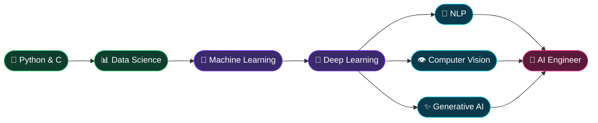
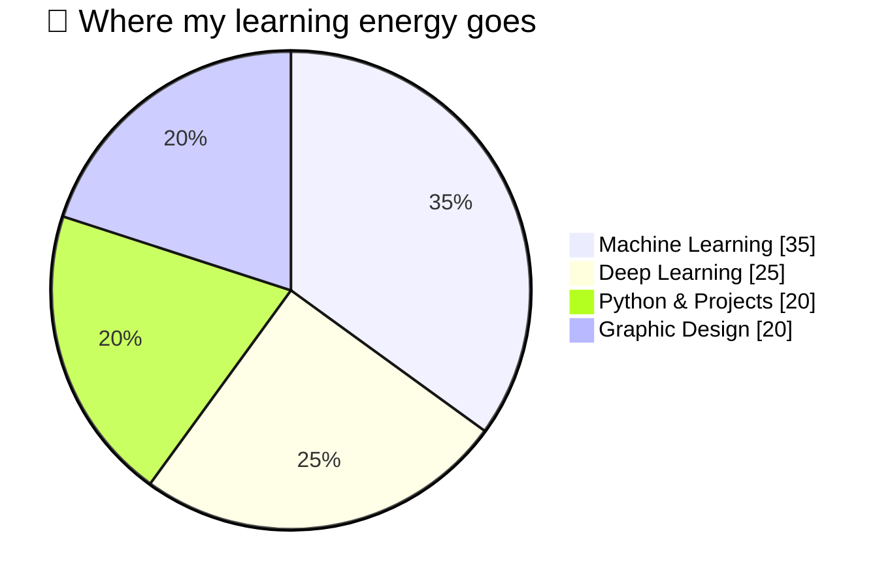

<!-- ═══════════════════════════════════════════════════════════════
     GitHub Profile README — Abusina Hossain (CraftoGamerz)
     Put this file in a PUBLIC repo named exactly:  CraftoGamerz/CraftoGamerz
     ═══════════════════════════════════════════════════════════════ -->

<!-- ░░░░░░░░░░░░░░░░░░░░░ HEADER BANNER ░░░░░░░░░░░░░░░░░░░░░ -->
<div align="center">


<!-- Typing animation -->
<a href="https://github.com/CraftoGamerz">
  
</a>

<br/>

<!-- Badges -->


<br/><br/>

<!-- Social buttons -->
<a href="https://github.com/CraftoGamerz"></a>
<a href="https://www.linkedin.com/in/abusina-hossain-600466388/"></a>
<a href="mailto:microsoft9564+gitpro@gmail.com"></a>

</div>


<!-- ░░░░░░░░░░░░░░░░░░░░░ ABOUT ME ░░░░░░░░░░░░░░░░░░░░░ -->

 **Hi there! Welcome to my corner of GitHub.**


## 🧑‍💻 `~/about-me`

```bash
abusina@github:~$ whoami
Abusina Hossain

abusina@github:~$ cat about.json
```

```json
{
  "name": "Abusina Hossain",
  "degree": "B.Tech — Artificial Intelligence & Machine Learning",
  "college": "JIS College of Engineering",
  "location": "Murshidabad, West Bengal, India 🇮🇳",
  "currently_exploring": ["Machine Learning", "Deep Learning", "NLP", "Computer Vision", "Generative AI"],
  "side_quest": "Graphic Design & Visual Creativity",
  "open_to": ["open-source contributions", "AI/ML collaborations", "creative projects"],
  "motto": "Questioning is the beginning of intelligence"
}
```

```bash
abusina@github:~$ ls -la ./what-i-do
```

* 🌱 Currently exploring **AI, Machine Learning, and Deep Learning**
* 💻 Passionate about **AI-driven applications, automation, and creative projects**
* 🎨 Love blending **art with technology** through **Graphic Design & Visual Creativity**
* 🧩 Enjoy solving logical problems and experimenting with new ideas
* 📚 Learning and building in **Data Science, Neural Networks, and Generative AI**

<br clear="right"/>


<!-- ░░░░░░░░░░░░░░░░░░░░░ WORKING DIRECTORY ░░░░░░░░░░░░░░░░░░░░░ -->

## 📂 `~/working-directory`

```bash
abusina@github:~$ tree ./abusina-hossain
```

```text
📦 abusina-hossain
 ┣ 📂 skills
 ┃ ┣ 🐍 python/            # AI, ML, data science, automation
 ┃ ┣ ⚙️  c/                # logic building & fundamentals
 ┃ ┗ 🌐 web/               # HTML · CSS · JavaScript (basic)
 ┣ 📂 ai-lab
 ┃ ┣ 🧠 neural-networks/
 ┃ ┣ 👁️  computer-vision/
 ┃ ┣ 💬 nlp/
 ┃ ┗ ✨ generative-ai/
 ┣ 📂 design-studio
 ┃ ┣ 🎨 photoshop/
 ┃ ┗ 🖋️  illustrator/
 ┣ 📂 goals
 ┃ ┣ 🚀 real-world-ai-projects/
 ┃ ┣ 🌍 open-source-contributions/
 ┃ ┗ 🧑‍💻 become-an-ai-engineer.md
 ┗ 📜 README.md              # you are here 👋
```


<!-- ░░░░░░░░░░░░░░░░░░░░░ SKILLS ░░░░░░░░░░░░░░░░░░░░░ -->

## 🧠 `~/skills-and-tools`

<div align="center">

**💻 Programming**


**🤖 AI / ML Frameworks**


<br/>


**🎨 Design Tools**


**🛠️ Development Tools**


**📚 Currently Learning**


</div>


<!-- ░░░░░░░░░░░░░░░░░░░░░ ROADMAP (Mermaid) ░░░░░░░░░░░░░░░░░░░░░ -->

## 🗺️ `~/roadmap`






<!-- ░░░░░░░░░░░░░░░░░░░░░ GITHUB STATS ░░░░░░░░░░░░░░░░░░░░░ -->

## 📊 `~/github-stats`

<div align="center">


<br/>


<br/><br/>


</div>

<details>
<summary>🏆 <b>Click to open my trophy cabinet</b></summary>
<br/>
<div align="center">


</div>
</details>


<!-- ░░░░░░░░░░░░░░░░░░░░░ FEATURED PROJECTS ░░░░░░░░░░░░░░░░░░░░░ -->

## 🚀 `~/featured-projects`

<!-- Replace REPO_NAME_1 / REPO_NAME_2 / ... with your real repository names -->

<div align="center">

<a href="https://github.com/CraftoGamerz/REPO_NAME_1">
  
</a>
<a href="https://github.com/CraftoGamerz/REPO_NAME_2">
  
</a>
<br/>
<a href="https://github.com/CraftoGamerz/REPO_NAME_3">
  
</a>
<a href="https://github.com/CraftoGamerz/REPO_NAME_4">
  
</a>

</div>


<!-- ░░░░░░░░░░░░░░░░░░░░░ GOALS ░░░░░░░░░░░░░░░░░░░░░ -->

## 🎯 `~/goals`

| 🎯 Goal | 📈 Progress |
|---|---|
| 🚀 Build real-world AI & ML projects |  |
| 🧑‍💻 Contribute to open-source projects |  |
| 📊 Understand AI applications in real life |  |
| 🌍 Become a skilled **AI Engineer** creating impactful technology |  |

<!-- Progress numbers are placeholders — change the number after /progress/ -->


<!-- ░░░░░░░░░░░░░░░░░░░░░ CONTRIBUTION SNAKE ░░░░░░░░░░░░░░░░░░░░░ -->
<!-- Needs the GitHub Action in .github/workflows/snake.yml (included separately).
     Until the first run finishes, this image will appear broken. -->

## 🐍 `~/contribution-snake`

<div align="center">
<picture>
  <source media="(prefers-color-scheme: dark)" srcset="https://raw.githubusercontent.com/CraftoGamerz/CraftoGamerz/output/github-snake-dark.svg"/>
  <source media="(prefers-color-scheme: light)" srcset="https://raw.githubusercontent.com/CraftoGamerz/CraftoGamerz/output/github-snake.svg"/>
  
</picture>
</div>


<!-- ░░░░░░░░░░░░░░░░░░░░░ FUN ░░░░░░░░░░░░░░░░░░░░░ -->

## 💬 `~/random-dev-joke`

<div align="center">


</div>


<!-- ░░░░░░░░░░░░░░░░░░░░░ CONNECT ░░░░░░░░░░░░░░░░░░░░░ -->

## 📫 `~/connect-with-me`

<div align="center">

<a href="https://github.com/CraftoGamerz"></a>
<a href="https://www.linkedin.com/in/abusina-hossain-600466388/"></a>
<a href="mailto:microsoft9564+gitpro@gmail.com"></a>

<br/><br/>

> ### *"Questioning is the beginning of intelligence"* 💡

<br/>


</div>


