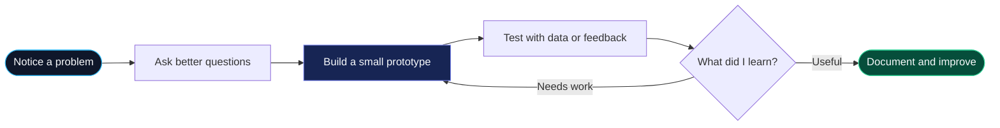

<!--
  CraftoGamerz profile README
  Repo: https://github.com/CraftoGamerz/CraftoGamerz
  Theme: midnight navy + electric cyan + violet
-->

<div align="center">
  

  <p>
    
  </p>

  <p>
    <a href="https://github.com/CraftoGamerz"></a>
    <a href="https://www.linkedin.com/in/abusina-hossain-600466388/"></a>
    <a href="mailto:microsoft9564+gitpro@gmail.com"></a>
  </p>

  <p>
    
    
    
  </p>
</div>

---

## `~/about` — Hello, I'm Abusina 👋


I'm a B.Tech student in **Artificial Intelligence & Machine Learning at JIS College of Engineering**. I enjoy exploring how software, data and thoughtful design can turn an idea into something people can actually use.

- 🧠 Exploring **machine learning, deep learning, data science and generative AI**
- 🛠️ Interested in **AI-driven applications, automation and practical prototypes**
- 🎨 Bringing a designer's eye to **visuals, interfaces and creative technology**
- 🔍 I like understanding *why* something works, not just making it run

<br clear="right" />

<div align="center">
<pre>
┌─[ abusina@craftogamerz ] ─ [ ~/now ]────────────────────┐
│                                                        │
│  $ whoami                                              │
│  B.Tech student · AI & Machine Learning                │
│                                                        │
│  $ current_mode                                        │
│  learn  →  prototype  →  test  →  iterate              │
│                                                        │
│  $ motto                                                │
│  "Questioning is the beginning of intelligence."       │
│                                                        │
└────────────────────────────────────────────────────────┘
</pre>
</div>

## `~/project-lab` — Things worth exploring 🚀

These are selected public repositories, chosen for what they demonstrate rather than star counts or commit totals.

<table>
  <tr>
    <td width="50%" valign="top">
      <h3>🛰️ <a href="https://github.com/CraftoGamerz/Thermal-Guard">Thermal-Guard</a></h3>
      <p>A satellite-intelligence prototype exploring real NASA FIRMS thermal observations, geographic review workflows, evidence exports and an XGBoost regression experiment.</p>
      <p>
        
        
        
      </p>
      <p><a href="https://github.com/CraftoGamerz/Thermal-Guard">↗ Explore source and implementation notes</a></p>
    </td>
    <td width="50%" valign="top">
      <h3>📈 <a href="https://github.com/CraftoGamerz/Modeling-and-Predicting-Epidemic-Spread-in-a-Community">SIR Epidemic Dashboard</a></h3>
      <p>An interactive epidemic-spread model playground with Euler/RK4 simulation, intervention scenarios, SIR charts, interpolation and numerical integration.</p>
      <p>
        
        
        
      </p>
      <p><a href="https://github.com/CraftoGamerz/Modeling-and-Predicting-Epidemic-Spread-in-a-Community">↗ Explore model, dashboard and documentation</a></p>
    </td>
  </tr>
  <tr>
    <td width="50%" valign="top">
      <h3>🎓 <a href="https://github.com/CraftoGamerz/EduSankalp">EduSankalp</a></h3>
      <p>An education-access concept focused on free learning, AI-assisted personalised paths, future skills and transparent education funding.</p>
      <p>
        
        
        
      </p>
      <p><a href="https://github.com/CraftoGamerz/EduSankalp">↗ Explore the concept and prototype</a></p>
    </td>
    <td width="50%" valign="top">
      <h3>🧪 More experiments</h3>
      <p>My repository list also includes smaller explorations and collaborative or forked work. I prefer to let each repo's README explain its scope clearly rather than label every experiment as a finished product.</p>
      <p><a href="https://github.com/CraftoGamerz?tab=repositories">↗ Browse all repositories</a></p>
    </td>
  </tr>
</table>

## `~/toolbox` — Tools I use and explore 🧰

<div align="center">
  <h4>Programming & web</h4>
  

  <h4>AI, data & computer vision</h4>
  
  <br />
  
  
  

  <h4>Build & design</h4>
  
</div>

<details>
  <summary><b>🧠 Open my current learning queue</b></summary>
  <br />

  <p>I'm learning these areas step by step. This is a learning map, not a claim of mastery or a percentage-complete score.</p>

  ```mermaid
  flowchart LR
      A[Python + data fundamentals] --> B[Machine learning]
      B --> C[Deep learning]
      C --> D[NLP]
      C --> E[Computer vision]
      C --> F[Generative AI]
      D --> G[Useful real-world applications]
      E --> G
      F --> G
      style A fill:#123047,stroke:#38BDF8,color:#F8FAFC
      style B fill:#172554,stroke:#818CF8,color:#F8FAFC
      style C fill:#312E81,stroke:#A78BFA,color:#F8FAFC
      style G fill:#064E3B,stroke:#34D399,color:#F8FAFC
  ```
</details>

## `~/working-directory` — A map of my dev universe 📂

```text
~/craftogamerz
├── ai-lab/                 # models, experiments and data workflows
│   ├── machine-learning/
│   ├── deep-learning/
│   ├── computer-vision/
│   └── generative-ai/
├── build-room/             # turning concepts into prototypes
│   ├── web-apps/
│   ├── automation/
│   └── data-visualisation/
├── design-studio/          # visual thinking meets technology
│   ├── graphics/
│   └── interface-ideas/
└── README.md               # you're here 👋
```

<sub>Think of this as a visual map of my interests, not a literal directory from a single repository.</sub>

## `~/build-loop` — My default workflow 🔁



## `~/playground` — A little GitHub side quest 🐍

<details>
  <summary><b>Click to reveal the contribution snake</b></summary>
  <br />
  <p>A tiny visual easter egg, not a productivity scoreboard. My profile is about the things I build and learn, not a streak counter.</p>
  <div align="center">
    <picture>
      <source media="(prefers-color-scheme: dark)" srcset="https://raw.githubusercontent.com/CraftoGamerz/CraftoGamerz/output/github-snake-dark.svg" />
      <source media="(prefers-color-scheme: light)" srcset="https://raw.githubusercontent.com/CraftoGamerz/CraftoGamerz/output/github-snake.svg" />
      
    </picture>
  </div>
  <sub>The image appears after the GitHub Actions workflow has run successfully once.</sub>
</details>

## `~/connect` — Have an interesting problem? 🤝

I'm interested in thoughtful AI/ML projects, creative technology, and collaborations where I can learn by building.

<div align="center">
  <a href="https://github.com/CraftoGamerz"></a>
  <a href="https://www.linkedin.com/in/abusina-hossain-600466388/"></a>
  <a href="mailto:microsoft9564+gitpro@gmail.com"></a>

  <br /><br />

  > **"Questioning is the beginning of intelligence."** 💡

  
</div>
